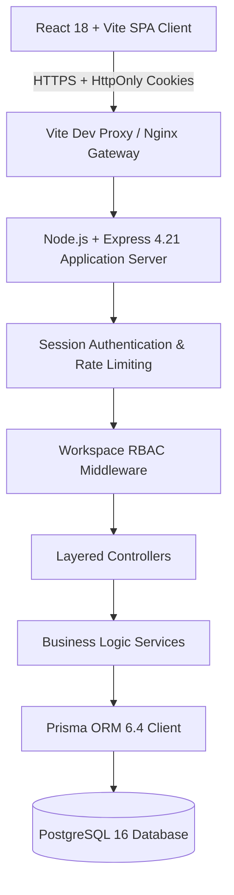

# DevFlow Architecture Document

## 1. System Overview

DevFlow is an Apple-inspired minimalist SaaS platform designed for high-velocity software engineering teams. The system incorporates strict multi-tenant workspace isolation, persistent session management, role-based access control (RBAC), and an interactive drag-and-drop Kanban workflow.

---

## 2. Layered Architecture

DevFlow follows a strict unidirectional data flow:

1. **Routing Layer (`src/routes/`):** Defines clean RESTful resource URIs, validates request bodies and query parameters with Zod schemas, and enforces authentication / RBAC guards.
2. **Middleware Layer (`src/middleware/`):**
   - `helmet`: HTTP header hardening.
   - `cors`: Strict origin validation with cookie authorization.
   - `express-rate-limit`: Rate limiting on sensitive authentication routes (`/login`, `/register`).
   - `authenticateSession`: Cryptographic session cookie lookup with DB validation.
   - `requireWorkspaceRole`: Verifies tenant membership and role permissions (`OWNER`, `ADMIN`, `MEMBER`).
   - `errorHandler`: Centralized operational error normalization (`AppError`).
3. **Controller Layer (`src/controllers/`):** Parses inputs, coordinates service calls, and formats consistent HTTP JSON responses.
4. **Service Layer (`src/services/`):** Core business logic, password hashing, multi-entity transactions, activity audit logging, and notification dispatches.
5. **Persistence Layer (`prisma/`):** Type-safe database queries via Prisma ORM connecting to PostgreSQL with UUID primary keys.

---

## 3. Security Model

- **Session Security:** Cookie-based session tokens generated using `crypto.randomBytes(32).toString('hex')`. Cookies are set with `HttpOnly: true`, `SameSite: Lax`, and `Secure: true` in production. Tokens are never stored in `localStorage`.
- **Password Security:** Salted and hashed using `bcrypt` (12 rounds) with compatibility for Argon2id.
- **Tenant Isolation:** Every Project, Task, Comment, and Activity Log belongs to a `workspaceId`. All database queries strictly scope records by `workspaceId`.
- **Input Sanitization:** All payload formats are parsed and validated using Zod schemas before reaching business logic.
