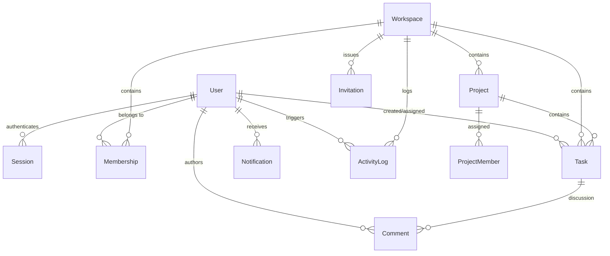

# DevFlow Database Schema Reference

## 1. Relational Entity Overview

DevFlow uses PostgreSQL 16 managed through Prisma ORM. All entities use UUID v4 primary keys (`@id @default(uuid())`) and maintain automated timestamps (`createdAt`, `updatedAt`).

---

## 2. Model Specifications

### 2.1 `User`
- `id` (UUID, PK)
- `email` (VarChar, Unique, Indexed)
- `passwordHash` (VarChar)
- `name` (VarChar)
- `avatar` (VarChar, Nullable)
- `bio` (Text, Nullable)
- `createdAt` / `updatedAt` (Timestamp)

### 2.2 `Session`
- `id` (UUID, PK)
- `token` (VarChar, Unique, Indexed)
- `userId` (UUID, FK -> User.id, Cascade)
- `userAgent` (Text, Nullable)
- `ipAddress` (VarChar, Nullable)
- `expiresAt` (Timestamp, Indexed)
- `createdAt` / `updatedAt` (Timestamp)

### 2.3 `Workspace`
- `id` (UUID, PK)
- `name` (VarChar)
- `description` (Text, Nullable)
- `createdAt` / `updatedAt` (Timestamp)

### 2.4 `Membership`
- `id` (UUID, PK)
- `role` (Enum: `OWNER`, `ADMIN`, `MEMBER`)
- `userId` (UUID, FK -> User.id, Cascade)
- `workspaceId` (UUID, FK -> Workspace.id, Cascade)
- `createdAt` / `updatedAt` (Timestamp)
- *Constraint:* `@@unique([userId, workspaceId])`

### 2.5 `Project`
- `id` (UUID, PK)
- `name` (VarChar)
- `description` (Text, Nullable)
- `status` (Enum: `PLANNING`, `ACTIVE`, `ON_HOLD`, `COMPLETED`)
- `priority` (Enum: `LOW`, `MEDIUM`, `HIGH`)
- `startDate` (Timestamp, Nullable)
- `deadline` (Timestamp, Nullable)
- `workspaceId` (UUID, FK -> Workspace.id, Cascade)
- `createdAt` / `updatedAt` (Timestamp)

### 2.6 `Task`
- `id` (UUID, PK)
- `title` (VarChar)
- `description` (Text, Nullable)
- `status` (Enum: `TODO`, `IN_PROGRESS`, `IN_REVIEW`, `COMPLETED`)
- `priority` (Enum: `LOW`, `MEDIUM`, `HIGH`, `URGENT`)
- `dueDate` (Timestamp, Nullable)
- `orderIndex` (Integer, Default 0)
- `projectId` (UUID, FK -> Project.id, Cascade)
- `workspaceId` (UUID, FK -> Workspace.id, Cascade)
- `creatorId` (UUID, FK -> User.id, Cascade)
- `assigneeId` (UUID, FK -> User.id, SetNull, Nullable)
- `createdAt` / `updatedAt` (Timestamp)
- *Index:* `@@index([workspaceId, status])`

### 2.7 `Comment`
- `id` (UUID, PK)
- `content` (Text)
- `taskId` (UUID, FK -> Task.id, Cascade)
- `userId` (UUID, FK -> User.id, Cascade)
- `createdAt` / `updatedAt` (Timestamp)

### 2.8 `ActivityLog`
- `id` (UUID, PK)
- `action` (VarChar)
- `entityType` (VarChar)
- `entityId` (UUID)
- `details` (JSON Text, Nullable)
- `workspaceId` (UUID, FK -> Workspace.id, Cascade)
- `userId` (UUID, FK -> User.id, Cascade)
- `createdAt` (Timestamp)

### 2.9 `Notification`
- `id` (UUID, PK)
- `type` (Enum: `TASK_ASSIGNED`, `TASK_COMMENT`, `PROJECT_INVITATION`, `UPCOMING_DEADLINE`, `STATUS_CHANGED`)
- `title` (VarChar)
- `message` (Text)
- `read` (Boolean, Default false)
- `link` (VarChar, Nullable)
- `userId` (UUID, FK -> User.id, Cascade)
- `createdAt` (Timestamp)
